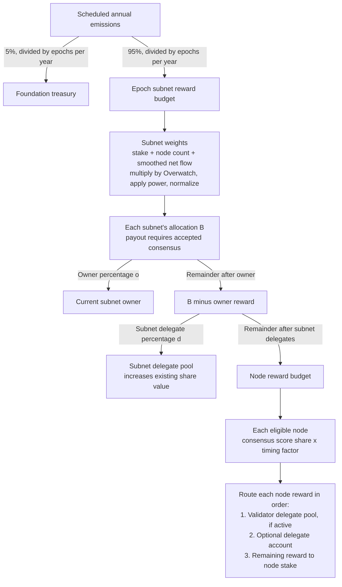

# Rewards

Emissions pass through three allocation layers: the chain's scheduled subnet budget, each subnet's share of that budget, and the recipients inside that subnet. Subnet allocation uses **delegate stake, eligible node count, and smoothed delegate-stake net flow**, multiplied by an **Overwatch weight**, then adjusted by a **distribution power** and normalized across eligible subnets.

Within a subnet, the owner receives a percentage first. Subnet delegators receive a configured percentage of the remainder, and the remaining node budget is divided by accepted consensus scores. Each node's reward can then be reduced by its attestation timing factor and shared with
its validator's delegators and optional delegate account.

## Allocation flow



The diagram shows budget allocation; actual credits depend on the conditions below. The foundation allocation requires a nonempty subnet-weight map. Proposal-validator bonuses and Overwatch-node rewards have separate budgets and are described under [Additional rewards](#additional-rewards).

## 1. Scheduled emissions become an epoch budget

The annual schedule reserves 5% for the foundation and 95% for subnets. Each annual pool is divided by `EpochsPerYear`, with integer rounding down, to produce its per-epoch budget. See [INFLATION.md](INFLATION.md) for the decay schedule and token amounts.

`handle_subnet_emission_weights` calculates subnet weights and stores them with that epoch's subnet budget in `FinalSubnetEmissionWeights`. If the weight map is nonempty, it also attempts to credit the foundation treasury. If the map is empty, neither scheduled pool is credited for that epoch. Later subnet consensus failures do not reverse an already credited foundation allocation.

## 2. The epoch subnet budget is divided across subnets

Global network unpause invalidates consensus rounds elected before or in the resume block.
At each subnet slot, settlement handles only the preceding epoch. If that round was invalidated,
its recorded allocation is retained in the reward capacitor exactly once. Older skipped rounds
are not replayed and expire with consensus history. Cancellation
does not pay round rewards or apply slashes, reputation changes, queue votes, or
probation progression. A fresh round can then be elected at that same slot.
Allocations skipped during the pause are not recreated. Already settled outcomes
remain unchanged. The historical election/proposal stays queryable and
`ConsensusRoundCancelled` identifies the discarded round.

`bash .maintain/benchmark-global-pause.sh` measures global unpause, the resume
selector, and cancellation with maximum-sized election snapshots.
Build the matching runtime with `runtime-benchmarks` first. Its partial weight
output must be merged into the existing table rather than replacing that table.

Only subnets with an exact elected consensus round for the epoch being settled participate. Preparing subnets without that election do not dilute the denominators. In the normal schedule, global epoch `G` allocates rewards for subnet round `G - 1`, which settles at the subnet's slot.

For each eligible subnet `s`, the inputs are:

| Input | What is measured |
| --- | --- |
| Delegate-stake share `D_s` | The subnet's elapsed-block EMA of `TotalSubnetDelegateStakeBalance`, divided by the sum of those EMAs for eligible subnets. This is delegation to the subnet, separate from delegation to validator identities or direct node stake. |
| Node-count share `C_s` | The number of eligible node IDs in the stored election round divided by their total across eligible subnets. This is the election's candidate count, not every Queued or admitted node. |
| Net-flow share `F_s` | Softmax of each subnet's signed EMA of external deposits minus withdrawals, measured in units, with sensitivity `K`. Pool balances do not normalize this signal; reward credits are excluded. |
| Overwatch multiplier `O_s` | The latest valid effective Overwatch subnet signal, scaled by `OverwatchWeightFactor` and capped at 100%; otherwise `DefaultOverwatchSubnetWeight`. An explicit zero signal stays zero. |

The `delegate_stake` input tracks the pool balance with an elapsed-block exponential moving
average: `S_new = S_old × (1 - alpha)^blocks + balance × (1 - (1 - alpha)^blocks)`.
Deposits, withdrawals, swap debits/credits, and pool rewards checkpoint the old balance first;
allocation advances idle pools as well. Same-block changes earn no elapsed-time credit, and
withdrawn stake fades gradually. The default closes approximately 63% of a sustained balance
gap over ten general epochs. Time uses chain blocks, including blocks during a network pause.

`set_subnet_delegate_stake_smoothing_alpha(value)` requires majority-collective authorization
and `0 < value < 1e18`. It checkpoints every existing subnet under the old setting before the
new one takes effect. `SubnetDelegateStakeEmas` stores each checkpoint's Q18-scaled balance
and block. New or missing records start at zero without backdated credit; draining a pool
preserves its decaying history, while subnet removal clears it. This accounting affects only
`delegate_stake`, independently of the separate signed `net_flow` factor.

Using ordinary fractions, the allocation formula is:

```text
base_s     = delegate_stake_factor * D_s
           + node_count_factor     * C_s
           + net_flow_factor       * F_s
adjusted_s = clamp(base_s * O_s, 0, 1) ^ SubnetDistributionPower
weight_s   = adjusted_s / sum(adjusted values for eligible subnets)
budget_s   = floor(epoch_subnet_budget * weight_s)
```

A zero total delegate balance or node count gives a zero share for that input. If there is no positive finite total adjusted weight, there is no allocation. Stored weights use `1e18 = 100%`;
conversion and a cumulative cap ensure their sum cannot exceed 100%.

The current storage defaults are:

| Parameter | Default | Effect |
| --- | ---: | --- |
| `SubnetWeightFactors.delegate_stake` | 40% | Contribution of relative smoothed subnet delegation. |
| `SubnetDelegateStakeSmoothingAlpha` | `1e18 / (10 × EpochLength)` | Per-block Q18 EMA response; smaller values adjust more slowly. |
| `SubnetWeightFactors.node_count` | 40% | Contribution of the eligible node count. |
| `SubnetWeightFactors.net_flow` | 20% | Contribution of the normalized signed net-flow EMA. |
| `SubnetNetFlowSmoothingAlpha` | `66_967_008_463_192_584` (Q18) | Per-general-epoch EMA alpha, approximately a ten-epoch half-life. |
| `SubnetNetFlowK` | `500` | Softmax sensitivity `K`; larger values spread the flow component more evenly. |
| `OverwatchWeightFactor` | 50% | Scale an available raw Overwatch signal before applying it. |
| `DefaultOverwatchSubnetWeight` | 50% | Use directly when the effective signal is missing, invalid, or has no entry for this subnet. |
| `SubnetDistributionPower` | 0.75 | Compress differences between positive combined weights before normalization. |

These are configurable defaults, not fixed percentages of the final token budget. For example, the same positive Overwatch multiplier applied to every subnet cancels during normalization;
relative differences between subnets affect their allocations.

Net flow is measured in token units, not as a percentage of pool balance. For general epoch `e`:

```text
flow_s[e] = external_deposits_s[e] - withdrawals_s[e]
ema_s[e]  = alpha * flow_s[e] + (1 - alpha) * ema_s[e - 1]
positive_s = exp((ema_s - max(eligible EMAs)) / K)
F_s        = positive_s / sum(eligible positive scores)
```

Allocation in general epoch `G` uses completed flows through `G - 1`. The open epoch never
changes that observation. Updates within an epoch accumulate signed deltas rather than repeatedly
advancing the EMA. Idle epochs contribute zero flow and decay the previous EMA, including epochs
elapsed during a global pause. Skipped epochs are handled with bounded binary exponentiation;
Q18 arithmetic introduces truncation toward zero, with fixed-point rounding in the decay factor.

Only external deposits and completed incoming swaps count as inflow. Withdrawals (including
withdrawn rewards) and outgoing swaps count as outflow when principal leaves the pool. Queued
principal counts for neither destination nor source while in transit; refunds never count as
destination inflow. Rewards credited to a pool and share transfers within a pool record no flow.
A deposit and equal withdrawal in the same epoch cancel exactly. Reward claims may therefore
produce negative flow even if the withdrawn funds originated as protocol rewards.

`SubnetNetFlows` stores the open epoch, its pending signed flow, and the completed-epoch EMA.
Signed magnitudes retain Q18 fractional atomic-unit precision and support the full u128 balance
range. A new or missing record starts at the current epoch with no invented history. Pool resets
preserve the signed history; permanent subnet removal deletes it, and residual withdrawals do
not recreate it. Reward settlement neither requires nor creates flow records.

`SubnetNetFlowK` stores `K` as a positive integer in whole native units; the calculation converts
it to the same 18-decimal atomic denomination as stake before using it. Its default is `500`.
This is a sensitivity parameter, not a balance threshold or an emission budget. The collective
call `set_subnet_net_flow_k(value)` requires `value > 0` and affects subsequent allocations.

`set_subnet_net_flow_smoothing_alpha(value)` requires `0 < value <= 1e18` (Q18). It finalizes
all completed observations for every existing subnet under the old alpha, then updates the
storage value. The current open epoch uses the new alpha when it completes. Both calls require
the majority collective (at least 2/3 in this runtime), emit the resulting configuration, and
leave previously finalized emission allocations unchanged. Alpha `1e18` uses only the most
recent completed epoch; the default approximates `1 - 2^(-1/10)`.

Softmax retains the ordering of negative EMAs: when every subnet has outflow, the least negative
EMA gets the highest flow share. Equal EMAs, including all zeros, split this component equally.
Only eligible subnets participate in normalization. Shares are rounded down to Q18, so negligible
shares can become zero; subtraction of the maximum prevents exponential overflow. This ordering
applies to the flow component; the other factors can still change the final reward ranking.

The raw Overwatch signal aggregates revealed subnet weights using normalized Overwatch-node stake weights, with their own `OverwatchStakeWeightFactor` exponent. It uses the retained close-time inputs of finalized Overwatch work. Future allocations read the latest effective signal; allocations already stored in `FinalSubnetEmissionWeights` are not recalculated. See [Overwatch epochs](CONSENSUS.md#overwatch-epochs) for settlement details.

There is no additional direct subnet-reputation or direct node-stake term in this allocation
formula. Those values can affect eligibility, consensus, penalties, and continued participation.

## 3. Each subnet allocation is split between owner, delegates, and nodes

Let `B` be the subnet's allocation, `o` its round's network-wide `SubnetOwnerPercentage`, and `d`
its round's subnet-specific `SubnetDelegateStakeRewardsPercentage`:

```text
owner_reward          = floor(B * o)
after_owner           = B - owner_reward
subnet_delegate_reward = floor(after_owner * d)
node_budget           = after_owner - subnet_delegate_reward
```

These three allocations sum exactly to `B` before payout eligibility and node-level rounding. The delegate percentage applies to the **remainder after the owner**, not to the original subnet allocation. The current owner default is 23%; the delegate percentage is configured per subnet
(its storage default is 10%). Settlement uses the consensus round's snapshotted percentages.

| Recipient | How the reward is credited |
| --- | --- |
| Subnet owner | A balance credit to the current `SubnetOwner` account. |
| Subnet delegators | Increase the subnet delegate pool's balance without issuing new shares, increasing the value of existing shares. The pool must have user-circulating shares. |
| Subnet nodes | Divide `node_budget` by consensus score, apply participation and eligibility rules, then route each node reward as described below. |

A subnet delegate pool with no circulating user shares receives nothing, even if locked minimum-liquidity shares remain. Its allocation is not redirected to the owner or nodes.

## 4. Consensus scores determine individual node rewards

The elected proposer submits node scores, and the round must pass both the stake-weighted attestation quorum and the distinct-validator-identity quorum, including its minimum identity-set requirement. The accepted canonical score sum supplies the denominator:

```text
node_score_share = node_score / sum(canonical submitted scores)
gross_node_reward = node_budget * node_score_share * node_reward_factor
```

The implementation represents shares and factors at `1e18` precision and rounds down at each division or multiplication. Consensus attestation weights determine whether the proposal passes; the accepted node scores determine each node's share of rewards.

At proposal submission, every node's normalized score must satisfy
`floor(score * 1e18 / canonical_score_sum) <= MaxSubnetNodeConsensusWeight`.
The network-wide cap defaults to **50%** (`500_000_000_000_000_000`); exactly
50% passes. Filtering ineligible/pending-removal nodes and collapsing duplicate
IDs to their lowest score happen before this check, so discarded entries cannot
dilute a node's weight. Scores retain their original units. The calculation uses
U256 intermediates; a canonical sum exceeding `u128` still fails with `ScoreOverflow`.
Empty and all-zero proposals have zero normalized weight.

The supermajority-collective call `set_max_subnet_node_consensus_weight(value)`
accepts `0 < value <= 1e18` and emits `SetMaxSubnetNodeConsensusWeight(value)`.
Changes apply to subsequent submissions, including rounds already elected, and
do not change accepted proposals. A proposal exceeding the cap fails with
`MaxSubnetNodeConsensusWeightExceeded` before proposal or automatic-attestation
state is written, allowing the proposer to submit corrected scores.

Voting weights freeze at the assigned-slot election with the candidate set and policy. The
snapshot includes each node's delegated allocation after node-count decay and stake-weight
power. Deposits, withdrawals, allocation updates, and node-count changes after election do not
change that round's voting power, including changes later in the election block. At proposal
submission, quarantined nodes are excluded from eligible attestors; weighted quorum uses the
sum of the remaining original weights. The complete election snapshot stays immutable, and
later quarantine does not change the proposal's recorded eligible set or denominator.

Only nodes captured as Active in the proposal snapshot can earn node-related rewards. Queued
nodes cannot be scored; Probation nodes can be scored but receive no node reward or associated
validator-pool/delegate-account allocation, including the round
that promotes them. Their scores remain in the canonical denominator, so withheld rewards are
not redistributed. Nodes absent from the score vector, with zero score, or quarantined for removal
receive no node reward. Reputation checks can quarantine a node during settlement. Settlement
can credit a departed node only for an otherwise eligible historical Active contribution.

If the admitted-node pending-removal set or its event list is full, that removal is skipped and
logged with the subnet and node IDs. Reputation processing and settlement continue; the failed
staging attempt leaves both collections unchanged.

An attesting node uses its stored timing factor: later attestation can reduce its reward. The proposer's automatic attestation has a 100% factor for its score-based node reward. A node without an attestation currently defaults to a 100% factor, although identity-supermajority endorsement can cause a reputation penalty and possible removal. Reduced or skipped node rewards are not redistributed to other nodes, and the score denominator is not recomputed to exclude unpaid nodes.

## 5. A node reward can be shared again

The node's validator identity controls two further destinations. These are separate from the subnet-wide delegate reward in step 3. For gross node reward `R`, validator delegate rate `v`, and optional delegate-account rate `a`, routing happens in this order:

```text
validator_pool_reward = floor(R * v)                 # only with circulating user shares
after_validator_pool  = R - validator_pool_reward
delegate_account_reward = floor(after_validator_pool * a)  # only if configured
node_stake_reward     = after_validator_pool - delegate_account_reward
```

If the validator pool has no circulating user shares, its deduction is zero and that amount stays in the node reward. If no delegate account is configured, that deduction is also zero. Validator pool credits increase existing share value; delegate-account credits increase `DelegateAccountStake`;
the remainder increases `NodeSubnetStake`. These are stake/accounting credits rather than immediate wallet payouts. The three credits for an individual node are applied atomically.

## Worked example

Assume the **subnet pool after the foundation split** is 10,000 tokens for the epoch, and one subnet's normalized allocation weight is 20%. Its budget is 2,000 tokens. With a 23% owner rate and a 10% subnet delegate rate:

| Allocation | Calculation | Tokens |
| --- | --- | ---: |
| Owner | `2,000 * 23%` | 460 |
| Subnet delegate pool | `(2,000 - 460) * 10%` | 154 |
| Node budget | `2,000 - 460 - 154` | 1,386 |

If three reward-eligible nodes have scores `3 : 2 : 1` and 100% reward factors, their gross rewards are **693, 462, and 231** tokens. If the first node's validator delegates receive 20%, and its delegate account receives 10% of the remainder, the 693 tokens become:

| Destination | Tokens |
| --- | ---: |
| Validator delegate pool | 138.6 |
| Delegate account | 55.44 |
| Node stake | 498.96 |

The example assumes accepted consensus, active delegate pools, and successful credits. Separate proposal-validator and Overwatch rewards are excluded.

## Additional rewards

Two rewards sit outside the scheduled foundation/subnet budget:

- **Proposal-validator reward:** an accepted, allocated round can additionally credit
  `BaseValidatorReward * validator_reward_factor` directly to the elected proposer's node stake. The factor depends on proposal timing and is separate from its score-based node reward. The
  proposer must retain its canonical validator link and avoid quarantine; a round without a
  positive emission allocation does not receive this bonus. This bonus does not pass through the node's delegate-pool or delegate-account split.
- **Overwatch-node rewards:** a completed Overwatch interval snapshots
  `OverwatchEpochEmissions * interval_multiplier` as its separate budget. Nonzero final Overwatch scores are normalized to allocate that budget to Overwatch-node stake. This compensates Overwatch participation separately from its influence on subnet weights.

## When allocated rewards remain uncredited

Failed consensus financial operations are stored individually in `PendingConsensusOperations`,
keyed by a global FIFO position. `PendingConsensusOperationsQueue` stores only its head and tail.
Each record contains an operation enum and its fixed expiry. The supported operations are:

- Owner payment: original account and full amount.
- Node reward: original node and gross amount, validator-pool generation/rate, and delegate
  beneficiary/rate. All destinations commit together, or all roll back.
- Proposer bonus: original node and full amount, without a delegate split.
- Subnet delegate reward: original pool generation and full amount.
- Node slash: original node, fixed amount, and recorded attestation percentage.

Accepted-round settlement collects failed rewards and appends their individual records as one
batch before returning, including from the zero-score branch. The append reads/writes the FIFO
state once and emits one `ConsensusOperationsQueued` event. FIFO order, frozen destinations,
pool generations, rates, and expiry are unchanged. Reward persistence opens no transaction and
has no application-error return: exhausting the SDK's transaction layers can fail a payment,
but cannot prevent its retry record from being stored or abort the slot. A failed slash validates
its reservation entirely before writing it, then unconditionally appends its single queued record;
no fallible work separates those writes. Financial credit attempts and idle retries retain their
transactional rollback behavior.

The subnet slot admits the worst-case batch before settlement. At the end of `on_initialize`,
unused reward-enqueue weight is subtracted from the returned weight in both dimensions. The
refund never includes payment attempts, reward snapshots, election, or the rejected/cancelled
settlement allowance. The internal meter retains the full reservation through optional cleanup
and swaps, so a refund itself cannot change which optional operations run.

Before node-metadata and consensus-history cleanup, `on_idle` reserves each operation's complete weight
before attempting it. Failure moves the unchanged record to the tail; later entries can progress.
Each entry is attempted at most once per hook invocation. Payment, reservation release where
applicable, and queue removal commit atomically. Retries never replay consensus, reputation,
probation, or membership changes. The original settlement and next election continue normally.

Every operation expires 100,800 blocks after its initial failure (seven days at the six-second
block target). Retries never extend that deadline. At or after expiry the operation is discarded
without crediting the capacitor. Idle execution is not guaranteed before expiry; expired records
can remain stored until cleanup reaches them. `ConsensusOperationsQueued` includes the originating
subnet ID, first FIFO operation ID, record count, and shared expiry. IDs advance with wrapping
u64 addition. Individual typed operations remain in `PendingConsensusOperations` and in
`ConsensusOperationApplied`/`ConsensusOperationExpired` events.

Ownership changes and subnet removal do not redirect or erase pending owner payments. Node
credits retain the persistent node/validator ownership mapping. Delayed pool credits benefit
current shareholders in the original pool generation; a reset generation cannot receive them.
A generation mismatch keeps the operation pending until expiry. Pending rewards are never
added to `SubnetRewardCapacitor`.

Missing elected proposals and failed consensus quorums retain **100% of their scheduled subnet allocation** in `SubnetRewardCapacitor(subnet_id)`, saturating at `u128::MAX`. Each processed round accumulates only once. Settlement in subnet epoch `S` uses `FinalSubnetEmissionWeights[S]` for round `S - 1`, independently of the current global epoch. Settlement processes only the preceding subnet epoch; skipped older allocations are not replayed. The separate proposal-validator bonus is not part of this allocation.

Only the elected subnet node's direct stake is slashed. Validator delegate pools and other
nodes owned by the same identity are unaffected. If a node deduction fails, it rolls back and
`SubnetNodeSlashFailed` records the reason. The fixed penalty enters the global queue;
reputation penalties, capacitor retention, and settlement continue. `PendingNodeSlashReservations`
provides a bounded per-node withdrawal index, grouping amounts by deadline. Only unpaid,
unexpired amounts are reserved. Payment or expiry releases them, and withdrawal checks ignore
expired reservations even if idle cleanup has not run. Node/subnet removal preserves the index.
Election itself does not lock direct stake; new slashes are capped by the balance remaining
after existing active reservations.

Unusable historical consensus evidence also terminates the round: its recorded allocation is
retained in the capacitor and `ConsensusRoundCancelled` is
emitted without rewards, penalties, or probation progression. Stored allocation percentages are
bounded to Q18 before multiplication. Accepted rewards do not touch net-flow accounting;
a missing flow record does not hold consensus open.

An accepted round with a nonzero score total releases up to `SubnetRewardCapacitorReleasePercentage` of its normal allocation, rounded down in atomic units and limited by the stored capacitor and remaining `u128` reward-budget capacity. The global percentage defaults to 10% and is updated through the supermajority-collective call `set_subnet_reward_capacitor_release_percentage(value)`, using Q18 (`1e18 = 100%`, `1e17 = 10%`). Values must be between 0% and 100%; zero disables releases. Updates apply at the next settlement. The combined budget follows the successful round's existing owner, subnet-delegate, and node reward split. At the default rate, a normal allocation of 100 tokens and a capacitor containing 100 tokens produce a budget of 110 tokens and leave 90 in the capacitor. A zero allocation or zero-score round leaves the capacitor untouched. Permanent subnet removal clears its remaining capacitor.

Allocation remains a ceiling, not a guaranteed payout: existing eligibility, timing, active-pool, and rounding rules apply to the combined budget. An **accepted zero-score round** still pays its normal owner and active subnet-delegate rewards, and can pay an eligible proposer bonus, but pays no score-based node rewards. Amounts left uncredited by these accepted-round rules are not added to the capacitor.

## Implementation references

- [Annual emissions and foundation split](src/supply/inflation.rs): `get_epoch_emissions`.
- [Subnet weights and reward budgets](src/utilities/slot.rs): `calculate_subnet_weights`,
  `get_net_flow_weights_for_eligible`, `subnet_reward_split`, and `emission_settlement_step`.
- [Signed net-flow EMA and softmax](src/utilities/subnet_net_flow.rs): epoch accounting and normalization.
- [Consensus reward distribution](src/bank/rewards.rs): `distribute_rewards_for_round`,
  `settle_subnet_owner_reward`, and `handle_subnet_delegate_stake_reward`.
- [Pending financial operations](src/bank/pending_operations.rs): frozen node reward splits,
  atomic category handlers, FIFO retries, expiry, and slash reservations.
- [Consensus scores and timing factors](src/consensus/attestation/subnet_validator.rs):
  canonicalization and the validator/attestor reward multiplier functions.
- [Round policy snapshots](src/utilities/era.rs): `consensus_policy_snapshot`.
- [Storage defaults and configuration](src/lib.rs): reward percentages and subnet weight factors.
