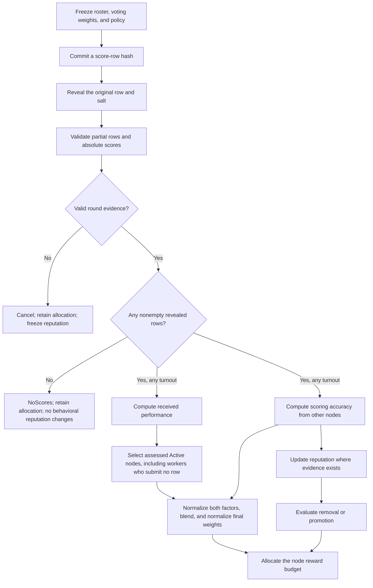
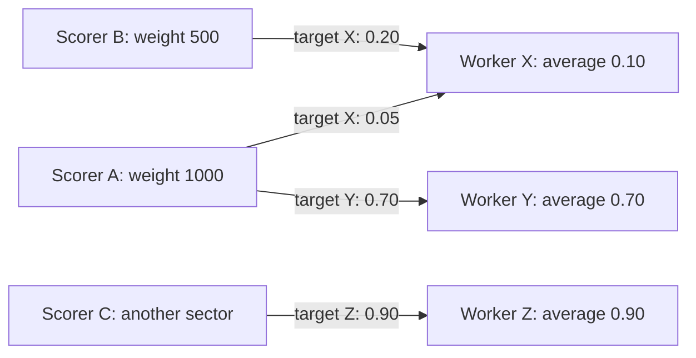
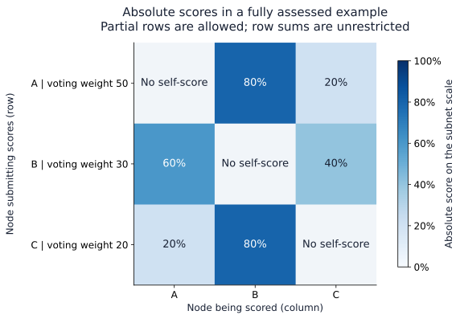
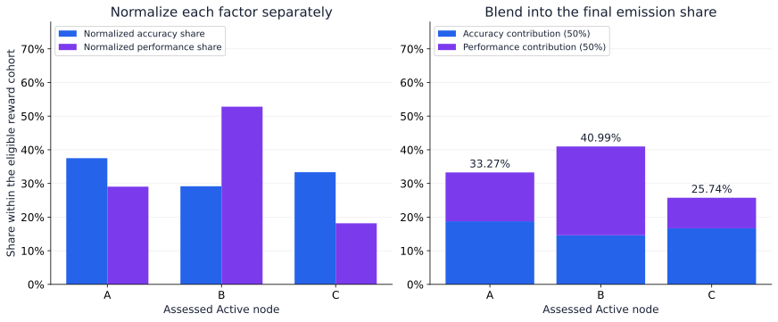
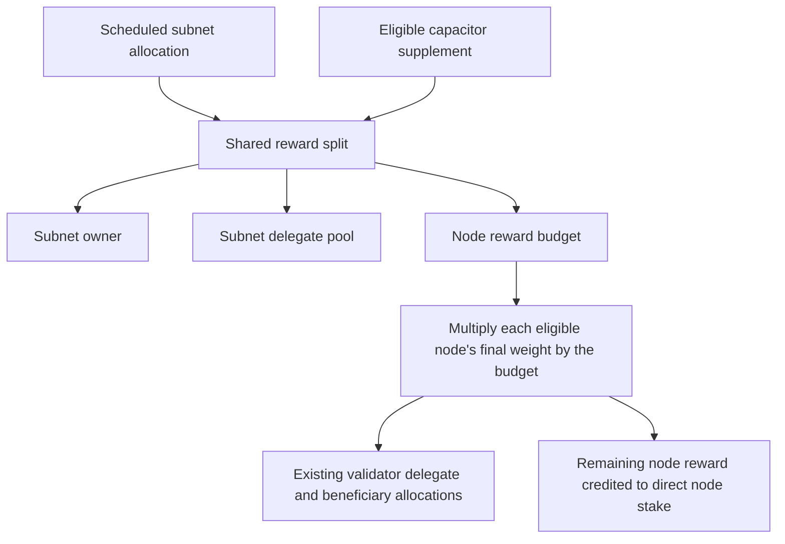
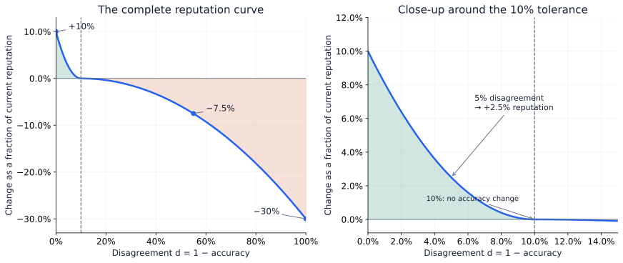
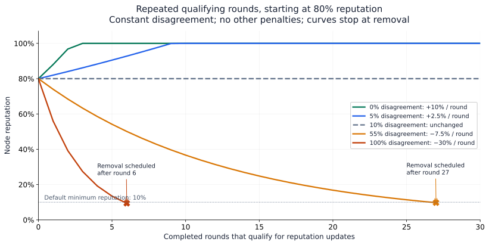
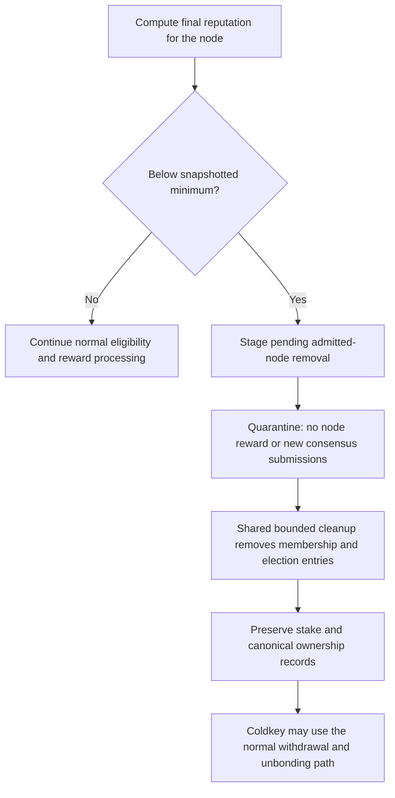

# Matrix consensus

Matrix lets the Active nodes in a subnet assess one another. Each eligible scorer
may score **any subset of other nodes in the round's target roster**. The chain
combines those assessments using frozen validator-delegate voting weights, then
calculates emissions and reputation.

**In plain language:** do useful work; if you also score peers, assess them accurately. Other
nodes' scores determine your received performance. Agreement with an independent,
stake-weighted reference determines your scoring accuracy. Performance and accuracy
together determine your share of the node reward budget. Accuracy also determines
whether your reputation goes up or down.

**Participation is node-based.** A Matrix subnet needs at least three admitted
nodes, but it has no minimum number or percentage of revealers, no revealed-stake
quorum, and no minimum number of validator identities. One validator may own all
the nodes. Any eligible nonempty revealed row is processed; absent nodes do not
invalidate the rows that arrived.

**Matrix does not currently slash stake.** Its consequences are lower emissions,
reputation decreases, and possible removal from the subnet. A reputation decrease
is not a token deduction. [Slashing and removal](#slashing-and-removal) explains
exactly what happens to membership and stake.

This guide describes the implementation in this checkout. Defaults can be changed;
use a round's stored snapshot when interpreting an actual result. Percentages in
examples are rounded for readability. Graphs are formula illustrations, not measured
network outcomes. The [capacity measurements](#capacity-measurements) are historical
benchmarks and predate the accuracy-based reputation and node-participation and partial-scoring updates.

## Contents

- [The main concepts](#the-main-concepts)
- [Algorithm parameters](#algorithm-parameters)
- [Who scores and who receives scores](#who-scores-and-who-receives-scores)
- [Where stake weight comes from](#where-stake-weight-comes-from)
- [A round from start to finish](#a-round-from-start-to-finish)
- [Submitting scores and commit/reveal encoding](#submitting-scores-and-commitreveal-encoding)
- [Participation and valid scores](#participation-and-valid-scores)
- [The scoring algorithm](#the-scoring-algorithm)
- [Worked example: from scores to emissions](#worked-example-from-scores-to-emissions)
- [Rewards and settlement](#rewards-and-settlement)
- [Accuracy-based reputation](#accuracy-based-reputation)
- [Other reputation changes and Probation](#other-reputation-changes-and-probation)
- [Slashing and removal](#slashing-and-removal)
- [Pauses, invalid rounds, and cleanup](#pauses-invalid-rounds-and-cleanup)
- [Operating and inspecting a Matrix subnet](#operating-and-inspecting-a-matrix-subnet)
- [Properties and limitations](#properties-and-limitations)
- [Source map and reproducing the graphs](#source-map-and-reproducing-the-graphs)
- [Capacity measurements](#capacity-measurements)

## The main concepts

These quantities serve different purposes:

| Quantity | Simple explanation | What it controls |
| --- | --- | --- |
| Frozen voting weight `t_i` | How much influence node `i` has when scoring others | Weighted averages |
| Received performance `P_i` | How highly other nodes score node `i` | One component of its emission share; zero performance also affects reputation |
| Scoring accuracy `A_i` | How closely its assessments match the independent reference | The other emission component and the accuracy reputation curve |
| Final emission weight `W_i` | Its percentage of the node reward budget | Gross node-related emissions for the round |
| Reputation `R_i` | A persistent measure updated across qualifying rounds | Continued membership and, for Probation nodes, promotion readiness |

A high voting weight is not an automatic reward entitlement. A node with zero
voting weight can still earn emissions if it receives a usable peer assessment
and has a positive final emission weight. Submitting its own scores is optional. Conversely, a large-stake node can lose
reputation for inaccurate scoring.



The diagram summarizes dependencies. In settlement, each node's reputation and
removal eligibility are resolved before its reward is credited. A node marked
for removal does not receive that round's node reward.

## Algorithm parameters

These are inputs to the calculation, frozen for each round. `MatrixParameters`
are network-wide: updating the global value is immediate, with no pending state
or subnet overrides. New rounds snapshot the current value; an open round keeps
its original parameters. The round's actual snapshot is authoritative.

All proportions use Q18: `Q = 1_000_000_000_000_000_000` represents `100%`.
These are integer proportions, not token amounts. For example, `Q / 10` is 10%.

| Quantity | Default | Role in the algorithm |
| --- | --- | --- |
| Accuracy allocation | 50% | Accuracy's share of the emission blend; the remainder is performance |
| Minimum subnet population | 3 admitted nodes | Minimum target roster; no minimum number of revealers or identities |
| Reputation tolerance | 10% | Disagreement boundary between the gain and loss curves |
| Maximum reputation decrease | 30% | Maximum accuracy-based loss as a fraction of current reputation |
| Maximum reputation increase | 10% | Maximum accuracy-based gain as a fraction of current reputation |
| Reputation increase exponent | 2 | Shape of the gain curve; any positive `u32` integer |
| Reputation decrease exponent | 2 | Shape of the loss curve; independent of the gain exponent |
| Commit-phase percentage | 50% | Fraction of an epoch reserved for commits; both phases must contain at least one block |
| Performance threshold | 0 | Performance must be strictly above this value for recovery, Probation progress, and positive-work counting |
| Probation promotion reputation | 100% | Reputation required alongside qualifying Probation rounds |
| Maximum admitted nodes | 64 | Admission ceiling, bounded by the supported roster maximum |

The shared policy snapshot also supplies minimum node reputation (default 10%),
other reputation factors, minimum emission-weight
threshold, Probation requirement, reward splits, and stake-weight transformations.
Using one immutable snapshot keeps all participants subject to the same rules for
the entire round.

## Who scores and who receives scores

**Scoring is optional, and each submitted row can cover any subset of targets.** A node
does not score itself, and only snapshotted eligible Active nodes can submit rows.
Active workers may earn through received performance alone. Probation nodes are
assessed by others while they establish a track record.

| Node status at snapshot | Can commit/reveal? | Included as a target? | Can receive node-related emissions for this round? |
| --- | --- | --- | --- |
| Active and eligible to participate | Yes, with its effective hotkey | Yes, optionally selected by other scorers | Yes, if another positive-weight node assesses it and it ends settlement eligible with a positive weight |
| Probation | No | Yes | No, including a round that promotes it |
| Queued | No | No | No |
| Quarantined or pending removal | No | Excluded when the round opens | No |

To submit scores, an Active node must be in the snapshotted eligible node map; Active
classification alone does not bypass that requirement. That map records each
node's validator for authorization and stake allocation, without requiring
distinct validators. The minimum population is **3 admitted nodes** (or the
network minimum if higher). The current Matrix cap is
**64 admitted nodes** at the default configuration, including both Active and
Probation targets, or the network node limit if lower. The configurable admission
limit cannot exceed the supported 64-node roster bound. Lowering it blocks new
admissions without evicting existing nodes or invalidating their rounds. With `N` targets, each eligible scorer can submit from `0` to `N - 1`
entries. The maximum matrix contains `N × (N - 1)` scores, but full coverage is
not required. Different sectors can score different target sets.

A node's effective hotkey is its node-specific override, if present, otherwise
its validator identity's hotkey. Hotkey rotation does not reset a commitment:
the new effective hotkey can reveal the already-committed row.

## Where stake weight comes from

**Simple explanation:** a validator has a delegate-stake pool and allocates a
percentage of its voting influence to each node it owns. Matrix freezes the
resulting node weights at the start of the round.

Matrix calls the same `snapshot_consensus_attestor_weights` helper used by
Attestation. It does not maintain a second stake-weight calculation.

With the default transformations:

```text
node voting weight = floor(validator delegate balance × node allocation / Q)
```

For example, a validator delegate balance of 1,000 TENSOR and an allocation of
25% to `(subnet_id, node_id)` gives that node an allocated weight equivalent to
250 TENSOR before any configured transformations. A 10% allocation gives 100.
**This allocation assigns voting influence; it does not transfer tokens.**

| Stake position | Used directly as Matrix voting weight? |
| --- | --- |
| Validator delegate stake, allocated to this node | Yes, through the shared transformation and snapshot |
| Direct node stake | No |
| Subnet delegate pool | No; it has separate subnet-funding and reward-allocation roles |

### Optional transformations

The shared helper can apply two transformations. Using 0–1
notation for their settings:

1. **Node-count decay:** allocated weight is divided by `n^(1 - c)` when applicable,
   where `c` is `consensus_validator_node_count_decay` and `n` is the validator's
   node count in this subnet, at least the number included in the snapshot.
   Default `c = 1` means no decay. This discourages concentrating many nodes under
   one identity when decay is enabled.
2. **Stake-weight power:** for positive decayed weights, a setting `p < 1` transforms
   the share of total decayed weight approximately as `Q × share^p`. Default
   `p = 1` preserves the decayed raw weights. `p = 0` gives equal transformed
   weight to positive-weight nodes; zero-weight nodes stay zero.

The shared helper defines floating-point conversion and integer rounding for
these optional transformations. If raw weight totals exceed `u128`, it rescales
with full-width arithmetic. The snapshot's actual weights and total are authoritative;
the formulas above explain the policy rather than replace its implementation.
Matrix's subsequent reward-share normalization, averages, accuracy, and reputation-rate
arithmetic use integers and U256 intermediates.

Stake, allocations, and membership can change after the snapshot, but those
changes cannot alter the current round's voting weights. They affect later rounds.

## A round from start to finish

### What is frozen

At the assigned subnet slot, the previous local round settles and the next round
opens before optional cleanup and queue admission. A new snapshot records:

- Ordered target nodes, their validator identities, and their classifications.
- Eligible Active submitters and their frozen voting weights, including zeros.
- The original total voting weight and identity membership.
- Reward splits, reputation policy, stake transformations, and Probation policy.
- Matrix emission and reputation settings. Shared Attestation quorum fields are
  carried in the policy structure but do not gate Matrix settlement.
- Commit, reveal, and end block boundaries.

Activation must first reach the existing consensus-eligibility epoch. Registering
or activating a subnet does not make an arbitrary current block a commit window.

### Commit, reveal, settle

For a round starting at block `B`, with epoch length `L >= 2`, let
`C = floor(L × commit_phase_percentage / Q)`. Configuration requires `0 < C < L`:

| Phase | Allowed blocks | Action |
| --- | --- | --- |
| Commit | `B <= block < B + C` | Submit the hash of the chosen partial list and salt |
| Reveal | `B + C <= block < B + L` | Submit that same raw row and salt |
| Settle | At the next assigned slot, `B + L` | Validate evidence, calculate outcomes, update reputation, and settle rewards |

For a 20-block round with the default 50% commit phase:

```text
Block offset     0                 10                 20
                 |-----------------|------------------|
Phase            COMMIT            REVEAL             SETTLE + OPEN NEXT
                 offsets 0–9       offsets 10–19
Snapshot         frozen here                           new snapshot here
```

The reveal-boundary block is already too late to commit. The end-boundary block
is already too late to reveal. At that block, newly opened-round commits may
follow the hook in the same block. Use `MatrixRounds` boundaries and the subnet's
slot, not a wall-clock timer or an unoffset global epoch number.

## Submitting scores and commit/reveal encoding

### Why use a commitment?

**Simple explanation:** seal your answer first; show it after everyone else's
commit window has closed. A node cannot inspect current-round revealed rows and
then submit a new commitment for that round.

A commitment is not a score submission by itself. A successful reveal is required
for scoring influence and accuracy; received-performance rewards do not require
your own reveal. The chain checks that the
revealed bytes match the previously committed bytes.

### Construct a partial score list

Build a strictly node-ID-ordered vector of `{ subnet_node_id: u32, score: u128 }`
containing the targets you assessed. Every listed target must belong to
`round.nodes` and differ from your own node. Self entries, duplicate IDs, unknown
IDs, out-of-order entries, and scores above Q are rejected. Omitted targets are
allowed. An empty list is also valid and records an abstention.

Every score is an **absolute Q18 value between 0 and 1**, inclusive. For example,
`0.7` is encoded as `700_000_000_000_000_000`. The subnet's off-chain protocol must
define a common measurement scale across its sectors. A list does not need to sum
to Q: scoring two targets `0.7` each leaves both scores at `0.7`, and scoring just
one target `0.7` also leaves it at `0.7`. There is no per-row rescaling.

Choose a fresh secret 32-byte salt. Persist the exact score list, salt, subnet ID,
round epoch, and node ID until the reveal is confirmed. The commitment binds the
exact list, including which targets are omitted and which receive explicit zeros.
Do not rewrite the list between committing and revealing.

### Exact encoding

The commitment is `T::Hashing::hash_of` of this SCALE tuple:

```text
(fixed_bytes("matrix/scores/v1"), subnet_id: u32, subnet_epoch: u32,
 subnet_node_id: u32, roster_hash: T::Hash,
 scores: Vec<SubnetNodeConsensusData>, salt: [u8; 32])
```

`roster_hash = T::Hashing::hash_of(round.nodes)`, including the stored validator
identities and classifications. The tag and salt are fixed arrays without length
prefixes; the score vector has the normal SCALE compact length prefix.
`Pallet::matrix_commitment` is the canonical helper. The bundled runtime uses
Blake2b-256. Solidity ABI encoding and Keccak do not produce this commitment.

Encoding test vector:

| Input | Value |
| --- | --- |
| Subnet / epoch / scorer | `7 / 11 / 1` |
| Roster `(node_id, validator_id)` | `(1,1), (2,2), (3,3)` |
| Classifications | All Active, start epoch `0` |
| Raw scores | `(2,5), (3,10)` |
| Salt | Byte `0x42` repeated 32 times |
| Roster hash | `3be00b8e24b50815a9db9da85ef610076e32e431baba4e48b67f29db2c603295` |
| Commitment | `fee5e7c5835d70e94b468107b8f1bade5dda6ba3d6f85f2ff94406105b7f443c` |

The tiny scores in this encoding test are literal Q18 base units, not 5% and 10%.

The effective hotkey submits:

```text
commit_matrix_scores(subnet_id, subnet_epoch, subnet_node_id, commitment)
reveal_matrix_scores(subnet_id, subnet_epoch, subnet_node_id, scores, salt)
```

Each node gets one successful commitment and one successful reveal per round.
A commitment cannot be replaced. Invalid attempts write no score/commitment state
and may be retried while the relevant phase remains open. A wrong commitment may
make a matching valid reveal impossible; it is not repairable by committing again.
Successful native commit/reveal calls waive their transaction fee; failures pay
normal fees, and execution through a precompile still costs gas.

### Absolute scores, omissions, and abstention

| Submission | Meaning |
| --- | --- |
| `(target, 0.7)` | An assessment of 0.7 on the subnet's common scale |
| `(target, 0)` | An explicit negative assessment; its voting weight enters that target's average |
| Target omitted | No assessment; contributes neither score nor denominator weight for that target |
| Empty list | Abstention; no voting influence or accuracy |
| Nonempty list containing only zeros | Valid assessments, not an abstention; can also supply zero-valued accuracy references |

Missing a reveal or submitting an empty list carries no automatic reputation
penalty: scoring others is optional. Those nodes can still earn performance
rewards from assessments they receive.

## Participation and valid scores

**The subnet population and the number of submissions are separate things.**
At least three admitted, non-quarantined nodes must be available when a round
opens. Once it opens, a nonempty revealed row is usable without waiting for any
other node. The algorithm never asks how many distinct validators submitted.

| Revealed rows | Outcome | How the algorithm handles it |
| --- | --- | --- |
| 2 of 64 eligible nodes | `Accepted` | Use those two rows with frozen node weights; assessed workers can earn performance rewards without submitting |
| 1 eligible node | `Accepted` | Its assessments of other nodes count; there is no external assessment or accuracy reference for the lone revealer |
| All nodes belong to one validator | `Accepted` if at least one nonempty row arrives | Each node submits separately and uses its allocated voting weight |
| Nonempty rows, but every revealer has zero voting weight | `Accepted` | Rows are valid but contribute zero weighted influence; all final weights are zero |
| No reveals, or only empty-list abstentions | `NoScores` | Retain the scheduled allocation; no behavioral reputation changes |
| Invalid stored evidence or a round invalidated by resume | `Cancelled` | Retain the allocation without rewards or reputation changes |

Missing rows contribute neither scores nor voting weight to the averages. Their
stake does not dilute the scores of the nodes that revealed. A small fraction of
the original frozen stake can therefore determine the result for that round.
Commit/reveal deadlines, sorted subsets, score bounds, authorization, and self-score exclusion
still apply to every submission.

**Acceptance does not guarantee a positive reward.** With one revealer, nobody
has assessed that node and nobody can supply its scoring reference. Its performance,
accuracy, and final emission weight are zero. The chain does not invent a self-score
or equal-share fallback. Its reputation stays unchanged because missing external
evidence is not a negative assessment. The other Active nodes can receive
performance rewards from its assessments without revealing scores themselves.
An explicit zero received performance or low final weight can still trigger its
separate reputation penalty when weighted assessments exist.

With two revealers, each can assess the other and supply an accuracy reference
for any targets they both assess. A target without another positive-weight
assessment is **excluded from the accuracy comparison**, not assigned a zero
reference. An actual weighted average of zero is a usable reference. With no
comparable targets, accuracy is unavailable and there is no accuracy reputation
adjustment. Disjoint sectors do not invalidate a round.

Accuracy reputation changes require a usable reference, not a participation quota.
Probation progression requires a weighted assessment of the Probation node, not
an identity supermajority. Scoring is optional, so Matrix does not apply the shared
Attestation non-participation reputation penalty. A valid nonempty row with zero
voting weight contributes no influence to other nodes' assessments.

## The scoring algorithm

### 1. Preserve absolute assessments and missing entries

Write `q_ij` for node `i`'s submitted Q18 score of target `j`. It exists only if
that target appears in the list. Every score is between 0 and Q; row sums have
no role in the calculation. Scores in different sectors must use the same
subnet-defined scale.

Let `V` be the eligible Active nodes with nonempty reveals, `t_i` their frozen
voting weights, and `S_j = {i in V: i explicitly assessed j}`. Self-scoring is
forbidden, so `j` cannot belong to `S_j`.

### 2. Calculate received performance

For target `j`:

```text
D_j = sum(i in S_j, t_i)
P_j = floor(sum(i in S_j, t_i × q_ij) / D_j), when D_j > 0
has_received_assessment_j = (D_j > 0)
```

If `D_j = 0`, record performance zero and `has_received_assessment = false`.
A zero-weight scorer cannot alone create a usable weighted assessment.

**Simple explanation:** average only the scores actually received by this target,
using the frozen influence of the nodes that supplied them. The rest of the
subnet does not dilute that average. The same calculation covers Probation targets,
although they cannot receive node rewards yet.

- One positive-weight assessor giving `0.7` produces `P_j = 0.7`, even if the
  other eight possible assessors in a 10-node roster submit nothing for that target.
- Weights `1,000` and `500`, with scores `0.05` and `0.2`, produce
  `(1,000 × 0.05 + 500 × 0.2) / 1,500 = 0.1`.
- If the second scorer omits the target, its average is `0.05`. If it explicitly
  gives zero instead, the average becomes approximately `0.0333333`.

### 3. Build an independent reference for each assessed target

To judge scorer `i`, remove **only its own contribution** from each target it
assessed. Other nodes owned by the same validator remain included.

```text
E_ij = S_j excluding i
D_ij = sum(k in E_ij, t_k)
r_ij = floor(sum(k in E_ij, t_k × q_kj) / D_ij), when D_ij > 0
C_i  = {j in i's submitted targets: D_ij > 0}
```

`C_i` is the set of comparable targets. Missing references are excluded; explicit
zero references remain. References stay on the absolute Q18 scale and are not
renormalized across targets. Unrelated assessments in another sector cannot
change this target's reference.

**Why exclude the scorer's row?** A node must not determine its own accuracy
reference. Here, “independent” means independent of that node's submission, not
independent ownership or proof against collusion.

### 4. Measure accuracy over comparable targets

When `C_i` is nonempty:

```text
d_i = floor(sum(j in C_i, abs(q_ij - r_ij)) / count(C_i))
A_i = Q - d_i
```

This is **mean absolute error**. Each comparable target contributes equally to
the scorer's accuracy, while its reference is stake-weighted. Both disagreement
`d_i` and accuracy `A_i` range from zero to Q.

| Submitted comparable scores | Independent references | Disagreement | Accuracy |
| --- | --- | ---: | ---: |
| `(0.7)` | `(0.7)` | 0% | 100% |
| `(0.7)` | `(0.5)` | 20% | 80% |
| `(0.8, 0.2)` | `(0.5, 0.5)` | 30% | 70% |
| `(1, 1)` | `(0, 0)` | 100% | 0% |

With no comparable targets, record `accuracy = 0` and
`has_accuracy_reference = false`; no accuracy reputation gain or loss applies.
A node with comparable targets and maximum disagreement instead has
`has_accuracy_reference = true` and accuracy zero, so the loss curve applies.

There is **no coverage multiplier or penalty for omitted targets**. A node that
scores one target perfectly can have the same accuracy as one that scores ten
perfectly. This supports sectors without requiring everyone to assess everyone.
It also means accuracy measures agreement on assessed work, not scoring volume.

For example, in a 10-node roster, node A can receive scores from the other nine
nodes while scoring only B. A's performance uses its nine incoming assessments.
Its accuracy uses only B, provided another positive-weight node also assessed B.
Those two factors then determine A's reward weight.



There are no implicit edges. B's omission of Y contributes no vote to Y. C's
assessment of Z affects neither X nor Y. X, Y, and Z can earn performance rewards
without submitting their own scores.

### 5. Combine accuracy and performance into emission weights

First form the reward cohort `E`: Active target nodes that received an assessment
from at least one other node with positive frozen voting weight.
A node does **not** need to submit scores to join `E`. Probation nodes remain
ineligible for node rewards, including their promotion round.

Normalize accuracy and performance **separately across `E`**, then blend:

```text
E     = {i: i is Active and D_i > 0}
A_i   = 0 for nodes without a usable accuracy reference
A_hat = normalize_to_Q18({A_i: i in E})
P_hat = normalize_to_Q18({P_i: i in E})
C_i   = accuracy_weight × A_hat_i + (Q - accuracy_weight) × P_hat_i
W     = normalize_to_Q18(C), with W_i = 0 outside E
```

At the default 50/50 blend, half the blend comes from normalized accuracy and
half from normalized performance. The final normalization makes positive total
weights sum to Q. Final weights are not multiplied by node stake again. Matrix applies no additional
per-node emission-weight cap beyond this normalization to 100%.

Each normalization uses largest remainders: assign `floor(value × Q / total)`
first, then distribute leftover units by descending fractional remainder, breaking
ties by ascending node ID. This makes every positive factor sum exactly to Q.
Only reward shares are normalized; submitted scores and accuracy references are not.

A factor whose total is zero contributes zero. If only one configured factor has
positive values, that surviving factor receives the full normalized allocation.
An explicitly disabled factor cannot revive the other factor's zero allocation.
If all combined values are zero, every final weight is zero.

A worker that submits no row, or abstains, has no accuracy component but can
receive performance rewards. If no eligible accuracy exists and performance is
enabled, the performance shares normalize to the full node reward allocation.
A 100% accuracy allocation explicitly disables performance rewards, so workers
without scoring accuracy receive zero under that setting.

**An assessment of zero and no assessment are different.** An explicit zero in
another positive-weight nonempty row satisfies the assessment requirement.
Such a node can still earn through its own accuracy; the zero-performance
reputation penalty can apply separately. With no usable external assessment,
`has_received_assessment` is false and the node receives no reward from either
component. Zero-voting-weight rows and empty abstentions do not supply an
assessment for this purpose. A nonempty zero-only row does supply assessments.

| Node behavior | Received assessment | Eligible reward components |
| --- | --- | --- |
| Performs work but submits no scores | Yes | Performance only |
| Submits a nonempty score row | Yes, including explicit zero | Performance and accuracy, where nonzero and enabled |
| Submits scores or remains silent | None | Neither |

For example, one node scores two workers 0.25 and 0.75. If those workers submit
nothing, they receive 25% and 75% of the node reward allocation when the performance
component is enabled. The scorer receives nothing because nobody assessed it.
The subnet's off-chain protocol determines which work merits each score. Commit/reveal
binds submissions to the round; it does not establish the truth of the underlying work.

## Worked example: from scores to emissions

Assume three Active nodes with the voting weights below. Their validator
ownership can be the same or different. All three reveal, and their frozen voting
weights are `A = 50`, `B = 30`, `C = 20`.
These absolute scores are shown as readable decimals (multiply by Q to encode):

| Scorer | Score for A | Score for B | Score for C | Frozen voting weight |
| --- | ---: | ---: | ---: | ---: |
| A | Self: omitted | 0.8 | 0.2 | 50 |
| B | 0.6 | Self: omitted | 0.4 | 30 |
| C | 0.2 | 0.8 | Self: omitted | 20 |



The diagonal is **excluded**, not a zero-valued self-vote in an average.

For A, only B and C contribute to received performance:

```text
P_A = (30 × 60% + 20 × 20%) / (30 + 20) = 44%
P_B = (50 × 80% + 20 × 80%) / (50 + 20) = 80%
P_C = (50 × 20% + 30 × 40%) / (50 + 30) = 27.5%
```

To judge A's scoring, exclude A's own row. For target B, C supplies 80%; for
target C, B supplies 40%. The reference is `(80%, 40%)`, without rescaling.
A submitted `(80%, 20%)`, giving mean disagreement `(0% + 20%) / 2 = 10%`
and accuracy `90%`.

Perform the same calculation for B and C, normalize each factor over the three
participants, and apply the default blend:

| Node | Received performance | Accuracy | Normalized performance share | Normalized accuracy share | Final emission share |
| --- | ---: | ---: | ---: | ---: | ---: |
| A | 44.00% | 90.0000% | 29.0429% | 37.5000% | **33.2715%** |
| B | 80.00% | 70.0000% | 52.8053% | 29.1667% | **40.9860%** |
| C | 27.50% | 80.0000% | 18.1518% | 33.3333% | **25.7426%** |



For a **node reward budget** of 1,000 TENSOR, gross node-related allocations are
approximately `332.7145`, `409.8597`, and `257.4257` TENSOR. This budget is after
the shared owner/subnet-delegate split; it is not necessarily the subnet's entire
allocation. Individual allocations then use the existing validator delegate and
beneficiary splits. Actual amounts are calculated in atomic units and rounded down.

The final weight is a relative reward share. Raw accuracy is a different quantity:
A's 90% accuracy means 10% disagreement, exactly the default neutral reputation
boundary. B has the highest emission share, but its 30% disagreement causes an
accuracy reputation decrease.

## Rewards and settlement

**Simple explanation:** Matrix decides how the subnet's node budget is divided.
The shared reward system decides how that budget is funded and where each
allocation is credited.



For each eligible Active node:

```text
gross_node_allocation = floor(W_i × RewardsData.subnet_node_rewards / Q)
```

Matrix has no elected proposer, proposer base reward, or attestation timing
multiplier. It reuses `RewardsData`, reward destinations, node-stake crediting,
validator pool/beneficiary splits, and the shared retry system. A pool without
user-circulating shares is not credited as though it had delegates. See
[the reward contract](../../../REWARDS.md) for the complete shared accounting.

### Failed rounds and the capacitor

A `NoScores` or `Cancelled` round retains its recorded scheduled subnet allocation
in `SubnetRewardCapacitor`, with no rewards. `NoScores` leaves behavioral
reputation and Probation progress unchanged because no weighted assessments exist. `Cancelled` freezes all reputation and Probation updates. The stored balance
saturates at `u128::MAX`.

An accepted round with positive node weights and a positive scheduled allocation
can release a supplement:

```text
supplement = min(
    stored capacitor balance,
    scheduled subnet allocation × release percentage,
    remaining representable reward-budget capacity
)
```

The release percentage defaults to 10%. With a scheduled allocation of 10 TENSOR
and 100 TENSOR stored, the supplement is 1 TENSOR, not 10 TENSOR. The combined budget
uses the round's reward split. Zero node weights or a zero allocation do not release
the capacitor. Owner and subnet-delegate credits are otherwise independent of
individual node weights.

### Exact-once outcomes and failed credits

Settlement marks the round complete before performing credits. Repeating settlement
does not repeat rewards or reputation changes. If a credit fails, the failed operation
is retained for the shared bounded retry process with its original destinations and
pool generations; it does not require re-running the consensus round.

A node quarantined or removed after revealing keeps its historical assessment in
the matrix, but its payment is withheld. A node that falls below minimum reputation
during settlement is also excluded from its node reward. Withheld percentages are
not redistributed to peers. Atomic rounding dust is not issued.

## Accuracy-based reputation

### The rule in everyday terms

An eligible Active node earns a larger reputation increase the closer its scoring
is to the independent reference. Beyond the tolerance, disagreement causes a loss
that follows the configured power curve (quadratic by default). At the boundary,
there is no accuracy adjustment.

This replaces the old positive-performance reputation increase for Active Matrix
nodes. There is no simultaneous inclusion bonus that offsets an accuracy penalty.
Probation nodes cannot score, so they retain their existing performance-based
recovery instead.

### Formulas

For this explanation, express proportions on a `0–1` scale:

- `d = 1 - accuracy`: disagreement.
- `t = reputation_tolerance`: the boundary.
- `I = max_reputation_increase`: maximum relative gain.
- `D = max_reputation_decrease`: maximum relative loss.
- `p_gain`, `p_loss`: independent positive integer curve exponents (both default to 2).
- `R`: current reputation.

```text
If d < t:
    gain_rate = I × ((t - d) / t)^p_gain
    R_after_accuracy = min(1, R × (1 + gain_rate))

If d > t:
    loss_rate = D × ((d - t) / (1 - t))^p_loss
    R_after_accuracy = R × (1 - loss_rate)

If d = t:
    R_after_accuracy = R
```

The default squared term makes a small boundary violation inexpensive and a large
one much more consequential. An exponent of 1 is linear; larger exponents flatten
changes near the boundary while preserving the endpoint maximum. For gains, moving closer to a perfect match increases
the rate smoothly up to the configured maximum.

The implementation stores Q18 integers. With the default exponent of 2, its
exact rate calculation uses:

```text
gain_rate_Q = floor(I_Q × (t_Q - d_Q)² / t_Q²)
loss_rate_Q = floor(D_Q × (d_Q - t_Q)² / (Q - t_Q)²)
delta      = floor(R_Q × applicable_rate_Q / Q)
```

Only the applicable branch is evaluated. U256 intermediates avoid product overflow;
the rate is floored once, then the reputation delta is floored. Extremely small
adjustments can therefore round to zero. Other exponents use Q18 binary
exponentiation with intermediate flooring and at most 32 iterations, even for
`u32::MAX`. The graphs below illustrate the default exponent of 2.

### Graph: gain and loss rates



The vertical axis is a **fraction of current reputation**, not percentage points
of the full reputation scale. For instance, a 10% gain on 80% reputation adds
8 percentage points and produces 88%. A 30% loss removes 24 points and produces 56%.

| Disagreement | Accuracy | Accuracy-only rate | Reputation starting at 80% |
| ---: | ---: | ---: | ---: |
| 0% | 100% | +10% | 88% |
| 2.5% | 97.5% | +5.625% | 84.5% |
| 5% | 95% | +2.5% | 82% |
| 7.5% | 92.5% | +0.625% | 80.5% |
| 10% | 90% | 0% | 80% |
| 32.5% | 67.5% | −1.875% | 78.5% |
| 55% | 45% | −7.5% | 74% |
| 77.5% | 22.5% | −16.875% | 66.5% |
| 100% | 0% | −30% | 56% |

These examples exclude the other reputation penalties described below.

### Graph: repeated qualifying rounds



The graph assumes a constant disagreement in every accepted round, a usable
reference, and no other penalties or policy changes. It counts rounds with usable
accuracy evidence, not elapsed epochs. Cancelled rounds and rounds without an
accuracy reference do not advance these accuracy curves.

At maximal disagreement, `80% × 0.7^6` is about `9.41%`, so the sixth qualifying
round crosses the default 10% minimum and schedules removal. Sustained 55%
disagreement crosses it after 27 rounds under these assumptions. The graph does
not continue predicting reputation after removal, when the node no longer participates.

### When the accuracy curve applies

All these conditions must hold:

1. The round is valid and accepted.
2. The node is Active in the snapshot and is not pending removal.
3. Its reputation entry exists and its starting reputation is at least the
   snapshotted minimum.
4. It supplied a valid, nonempty revealed row with a usable reference from other nodes.

An unavailable independent reference is not treated as maximum disagreement.
A reference made of actual zero assessments is available and participates normally.
It causes neither an accuracy gain nor an accuracy loss. The result's
`has_accuracy_reference` flag makes that distinction visible. Other applicable
penalties still apply.

### Bounds and configurable edge cases

- Reputation is capped at `Q` (100%). A gain can reach the cap in a finite number
  of rounds; it is not merely a fraction of the remaining headroom.
- With `t = 0`, a perfect match still receives the maximum gain. Every positive
  disagreement uses the loss curve. This special case avoids dividing by zero.
- `t = Q` is rejected; the loss curve requires `t < Q`.
- A zero maximum gain or loss disables that direction independently. It does not
  restore the old positive-performance bonus.
- Proportional gains cannot recover reputation from zero. Normally a node below
  the minimum is already subject to removal rather than recovery as an Active node.
- Reputation curves are independent of `accuracy_weight`, which controls emissions.
  Setting accuracy's emission allocation to zero does not disable reputation rules.

## Other reputation changes and Probation

### Order matters

Here “positive performance” means strictly above the snapshotted
`performance_threshold`, which defaults to zero. The threshold governs reputation
and progression; it does not rewrite performance scores or their reward shares.

For an eligible node in a valid round, settlement calculates reputation locally
in this order. No identity or stake participation threshold gates these changes:

| Order | Condition | Adjustment |
| ---: | --- | --- |
| 1 | Active node with an independent accuracy reference | Apply the configured accuracy gain or loss |
| 1, alternative | Probation node with positive received performance | Apply the shared `included_increase` recovery formula |
| 2 | At least one other positive-weight node assessed it, but received performance is at or below the threshold | Apply `absent_decrease` |
| 3 | An external weighted assessment exists and the Active node's final emission weight is strictly below the configured minimum weight | Apply `below_min_weight_decrease` |
| 4 | Final reputation is below the minimum | Mark for removal; skip its node reward |

Each of these two shared decrease factors defaults to **10% of reputation at
that step**. The minimum-weight threshold itself defaults to **zero**, disabling
that particular penalty unless the threshold is positive. It tests
`W_i`, the final emission share, not raw performance or accuracy.

For example, a node at 80% reputation with perfect accuracy first reaches 88%.
If a configured minimum-weight rule then applies a 10% decrease, it finishes at
`88% × 0.9 = 79.2%`. Accurate scoring does not guarantee a net increase when another
penalty applies.

A node that submits no scores but receives positive performance gets no accuracy
increase or non-participation penalty. Its reputation stays unchanged unless its
final reward share triggers a configured minimum-weight penalty. An empty
revealed list is treated the same way. A received zero can still trigger the
absence penalty; omitting one's own row does not excuse poor assessed performance.

Changes use the round's snapshotted factors; later policy changes cannot alter them.
The final change is persisted once and emits `NodeReputationUpdate`. An unchanged
value produces neither that write nor that event.

### Probation and promotion

Probation nodes cannot submit rows or earn node-related emissions, but Active
nodes can score them. When a valid round supplies at least one external
positive-weight assessment of the Probation node:

- Positive received performance applies the shared reputation recovery and increments
  `SubnetNodeProbationProgress`.
- Performance at or below the configured threshold incurs the absence decrease
  and resets that progress.
- Promotion requires `probation_promotion_reputation` (default 100%) and the
  configured number of qualifying rounds. `ProbationRounds` defaults to two.
- Quarantined nodes cannot progress. Cancelled rounds and rounds with no external
  weighted assessment freeze progress. One positive-weight revealer is enough to
  assess and advance a Probation node.

The shared recovery uses `min(1, R + f × R^(1 + f))` in 0–1 notation, where `f`
is `included_increase` (default 10%). This is distinct from Active Matrix nodes'
power-curve accuracy rule. A node already below the minimum is removed rather than
receiving this recovery.

Promotion emits `SubnetNodePromoted` and enables a subsequent snapshot, possibly
opened later in the same hook. It does not grant rewards for the completed
Probation round. Bootstrap nodes admitted while a subnet is still Registered can
start Active through the existing registration lifecycle; later admitted newcomers
normally enter Probation.

### Subnet reputation

Subnet reputation is separate from each node's reputation. An accepted Matrix round
increases it through the shared helper when at least the snapshotted
`min_subnet_nodes` targets have positive received performance. The helper's
participation input is the fraction of eligible **nodes** with nonempty reveals,
regardless of validator ownership or voting stake. `NoScores` does not apply the
Attestation proposer-absence reputation/slashing path. Shared subnet lifecycle
checks still apply independently of this consensus mechanism.

## Slashing and removal

### Does Matrix slash a node's stake?

**No. The current Matrix settlement path does not apply a token slash** for
inaccurate scoring, missed commitments, missed reveals, abstentions, or a round
with no scores. It has no elected proposer and does not invoke the Attestation proposer
slash path. Some slash settings exist in the shared policy structure, but their
presence does not make them active Matrix rules.

| Outcome | What changes | Is this a Matrix stake slash? |
| --- | --- | --- |
| Lower scoring accuracy | Accuracy component of emissions; possibly reputation | No |
| Missed/abstained reveal | No accuracy component; assessed workers can still earn performance rewards; no automatic reputation penalty | No |
| No nonempty revealed lists | Recorded allocation retained; behavioral reputation unchanged | No |
| Reputation below minimum | Quarantine/removal from subnet participation | No |
| A hypothetical rule deducting already-staked tokens | Would reduce a stake balance | Such a Matrix rule is not implemented |

Registration burns, transaction/gas charges, and the chain's block-validator
slashing rules are separate mechanisms. A network validator identity is not the
same role as a BABE/GRANDPA block-producing validator. See the
[validator guide](../../../../../docs/validators.md) for the latter.

### What removal does

The default minimum node reputation is **10%**. Removal uses the round's
snapshotted minimum and a strict comparison: `R < minimum`.
Exactly the minimum is not below it.



Staging removal makes the node ineligible for its settlement reward immediately;
physical cleanup may finish later. A pending node cannot commit or reveal Matrix
scores and is excluded when new rounds open. Already accepted rows stay in their
original round; removal does not rewrite everyone else's averages or redistribute
the removed node's emission share.

The shared removal helper preserves `NodeSubnetStake` and `SubnetNodeValidatorId`
so the canonical coldkey retains access to stake after membership is removed.
Withdrawal and unbonding remain explicit staking operations; removal is neither
a slash nor an automatic transfer to a wallet. See [staking and exits](../../../../../AGENTS.md#remove-stake-and-claim)
and the [node-staking implementation](../../stake/node_staking.rs).

In a valid round, including `NoScores`, a node already below the minimum can be
staged for removal without another accuracy adjustment. This checks its existing
reputation. Cancelled rounds do not stage removals.

## Pauses, invalid rounds, and cleanup

Global pause blocks the public Matrix calls through the common pause guard.
Global resume invalidates unfinished rounds opened at or before the resume block.
Their commits/reveals are rejected, and a subsequently processed cancelled round
retains its recorded allocation without rewards or reputation updates.

At a subnet slot, settlement processes only the immediately preceding local epoch.
Older skipped rounds are not replayed; their skipped allocations are not invented.
A missing round is simply not settled.

Before calculation, settlement validates the stored roster order and bounds
(3 through 64), eligible node ownership, stake total, parameters, and the shape
and absolute Q18 bounds of all stored partial rows. Unusable evidence produces `Cancelled`
with no node metrics. Valid evidence with no nonempty rows produces `NoScores`,
with zero node metrics and no behavioral reputation changes. Both outcomes use the shared
allocation-retention path, but only `Cancelled` freezes all reputation changes.

History cleanup runs incrementally through the shared `on_idle` scheduler. Live
subnets retain at least 128 completed local epochs plus the current round; deletion
is best effort when idle block weight is available, so history can accumulate beyond
that window. Removal preserves the global configuration and schedules historical records
for bounded cleanup. Financial retries keep priority over history cleanup.

## Operating and inspecting a Matrix subnet

### Worker sequence

Nodes that only perform work do not need to commit or reveal scores. They must
still expose their work to the subnet's off-chain assessment protocol. The
following sequence applies to nodes that choose to submit assessments.

1. Read the subnet's mechanism and the exact `MatrixRounds(subnet_id, epoch)` record.
   Verify that your node is an eligible submitter and determine its effective hotkey.
2. Run the subnet's off-chain work/scoring protocol. Build an ordered subset of the stored
   roster with absolute Q18 scores. Include explicit zeros only for targets assessed as zero.
3. Save the raw row and a fresh secret salt. Calculate the commitment with the
   canonical SCALE layout and submit during the commit phase.
4. Confirm commitment inclusion. Reveal the saved bytes during the reveal phase;
   confirm that the reveal succeeded before discarding the salt.
5. After settlement, inspect the outcome, weights, reputation events, and reward
   results. A successful reveal is not a promise of a positive reward.
6. On timeout, reconcile stored state and events before retrying. Do not assume an
   unobserved transaction failed; duplicate successful commitments/reveals are rejected.

The pallet does not execute the subnet's workload or prove that a score describes
real-world performance. Peer discovery, task validation, scoring methodology,
secure key handling, and timely submission remain responsibilities of the subnet
application. Do not disclose salts before the reveal phase.

### Storage to inspect

| Storage | Key | What it tells you |
| --- | --- | --- |
| `SubnetsData` | Subnet ID | Mechanism and lifecycle state |
| `MatrixConfig` | No key; network-wide | Current algorithm parameters; writes apply immediately for future snapshots |
| `MatrixRounds` | Subnet ID, local epoch | Frozen roster, identities, weights, policy, parameters, and block boundaries |
| `MatrixCommitments` | Subnet ID, local epoch, node ID | Commitment hash |
| `MatrixRows` | Subnet ID, local epoch, node ID | Exact revealed partial list of absolute Q18 scores |
| `MatrixResults` | Subnet ID, local epoch | Outcome, revealed weight, nonempty-row node count, and per-node metrics |
| `SubnetNodeReputation` | Subnet ID, node ID | Current reputation, which may differ from a past round's value |
| `SubnetNodeProbationProgress` | Subnet ID, node ID | Qualifying Probation progress |
| `PendingAdmittedNodeRemovals` | Subnet ID | Nodes already quarantined pending physical removal |
| `SubnetRewardCapacitor` | Subnet ID | Retained allocation available for future eligible supplements |
| `ConsensusRoundSettlementStatus` | Subnet ID, local epoch | Whether a round's outcome has been finalized |

Each node result contains `performance`, `has_received_assessment`, `accuracy`,
`has_accuracy_reference`, and `weight`. The assessment flag distinguishes an explicit
zero score from missing external evidence. `revealed_nodes` counts eligible nodes that supplied nonempty rows,
including nodes with zero voting weight. `revealed_weight` sums their frozen node
weights. Neither is an acceptance threshold. The ownership map's length counts
eligible nodes, not distinct validator IDs.

Subnet RPC information reports `consensusMechanism: "matrix"`. Existing Attestation
round queries remain specific to Attestation; Matrix reports no actionable
Attestation proposal/attestation window. Use metadata-backed Matrix storage queries
for Matrix rounds. No synthetic proposer is stored.

### Events

| Event | Meaning |
| --- | --- |
| `MatrixRoundOpened` | New round snapshot stored |
| `MatrixScoresCommitted` | A node's commitment accepted |
| `MatrixScoresRevealed` | A reveal accepted, including whether it abstained |
| `MatrixRoundSettled` | Final outcome: `Accepted`, `NoScores`, or `Cancelled` |
| `ConsensusRoundCancelled` | Shared cancellation/allocation-retention path processed |
| `NodeReputationUpdate` / `SubnetReputationUpdate` | Reputation changed |
| `SubnetNodePromoted` / `SubnetNodeRemoved` | Membership progression or completed removal |
| `SubnetRewards` | Shared reward reporting for settlement |

### Common submission failures

| Error | Typical cause |
| --- | --- |
| `InvalidConsensusMechanism` | The subnet is not configured for the called mechanism |
| `MatrixRoundNotFound` | The requested round has not opened or is no longer retained |
| `MatrixRoundClosed` | The round has already settled |
| `ConsensusRoundCancelled` | The round was invalidated by global resume |
| `InvalidValidatorId` | The authenticated node/validator identity is not an eligible submitter in this snapshot |
| `MatrixNodeQuarantined` | The node is pending removal |
| `NotCommitPeriod` / `NotRevealPeriod` | The current block is outside the snapshotted commit or reveal phase |
| `AlreadyCommitted` / `AlreadyRevealed` | That node already completed the relevant action |
| `NoCommitFound` | Reveal was attempted without a stored commitment |
| `InvalidMatrixScores` | Self/unknown/duplicate target, invalid ordering, or score above Q |
| `RevealMismatch` | Scores, salt, or commitment inputs do not match |

Wrong-hotkey calls also fail the shared ownership checks. These submission errors
are not immediate reputation or stake penalties. A node that never reveals has
no accuracy component but may still receive performance rewards from peer assessments.

## Properties and limitations

| Feature | What it achieves | What it does not establish |
| --- | --- | --- |
| Frozen voting and policy snapshots | Prevents mid-round stake/configuration changes from rewriting the calculation | Does not freeze future rounds |
| Commit/reveal | Prevents choosing a new commitment after current-round reveals begin | Does not prevent prior-round copying or coordination before commits |
| Absolute Q18 scores and per-target averages | Keeps partial and full lists comparable; omissions do not dilute assessments | Requires a common off-chain measurement scale |
| Accuracy over overlapping targets | Supports independent sectors without a coverage requirement | Does not reward scoring volume; selecting easy targets can yield high accuracy |
| No self-score | Removes a direct self-vote | Does not exclude all same-validator siblings from received performance |
| Accuracy reference from other nodes | Excludes the scorer's own row from its accuracy benchmark | Does not prevent collusion, including among nodes sharing a validator |
| No participation quorum | Scores remain usable at any turnout and with any validator ownership distribution | A small participating stake fraction can determine the round's result |
| Evidence-based reputation | Applies accuracy rules when a reference exists; optional scoring enables dedicated workers | Sparse peer evidence is not proof of truthful scores |
| Configurable reputation power curves | Graduates rewards and penalties by distance from peer consensus | Agreement is not independent proof of off-chain correctness |
| Exact-once settlement and retained failed credits | Prevents replaying outcomes and retains failed payment operations | Does not make every credit immediately successful |

The accuracy reference is stake-weighted peer agreement. An honest minority can
therefore disagree with the majority and receive an accuracy penalty. Tolerance,
maximum rates, and the subnet's off-chain scoring protocol should be considered
together. The emissions blend and reputation thresholds answer different policy
questions and can be configured independently.

For `N` targets and `M` submitters, there are at most `M × (N - 1)` submitted scores.
The implementation caches weighted column totals and subtracts the scorer's own
contribution to avoid rescanning every row for every scorer/target reference. Work and retained
score data still grow approximately quadratically when all nodes submit.

## Source map and reproducing the graphs

| Topic | Source |
| --- | --- |
| Types, node bound, parameter validation, result fields | [types.rs](types.rs) |
| Snapshots, commitments, submission guards | [mod.rs](mod.rs) |
| Normalization, performance, independent accuracy, emission weights, reputation rates | [math.rs](math.rs) |
| Settlement, reputation ordering, reward eligibility | [settlement.rs](settlement.rs) |
| Incremental Matrix history deletion | [history.rs](history.rs) |
| Shared voting-weight snapshot | [Attestation snapshot helper](../attestation/subnet_validator.rs) |
| Shared reward credits and Probation progression | [rewards.rs](../../bank/rewards.rs) |
| Shared reputation helpers | [reputation.rs](../../utilities/reputation.rs) |
| Removal and preserved stake ownership | [subnet_node.rs](../../utilities/subnet_node.rs) |
| Runtime defaults and epoch configuration | [common.rs](../../../../../runtime/src/configs/common.rs) |
| Behavioral examples and regression coverage | [Matrix tests](../../tests/matrix.rs) |

The four SVG graphs are committed alongside this guide, so reading the README
requires no plotting tools or network service. Mermaid diagrams render in Markdown
viewers that support Mermaid; nearby prose and tables explain the same behavior.

[figures/generate.py](figures/generate.py) uses Matplotlib to regenerate the plots.
It evaluates the reputation examples with Q18 integer arithmetic, checks known
points on both curves, verifies the worked example against exact fractions, and
stops simulated trajectories when reputation falls below the configured minimum.
[figures/examples.json](figures/examples.json) contains the underlying example data.
This is documentation tooling, not runtime code or a benchmark implementation.

From the repository root, with Matplotlib installed in a Python environment:

```sh
python3 pallets/network/src/consensus/matrix/figures/generate.py
```

To additionally generate PNG previews for visual inspection:

```sh
python3 pallets/network/src/consensus/matrix/figures/generate.py --preview-dir /tmp/matrix-readme-figures
```

<a id="capacity-measurements"></a>

## Capacity measurements — 2026-11-25

These measurements predate the 2026-11-26 accuracy-based reputation update and
the subsequent switch to node-based participation without quorum. They are
historical evidence, not a calibration of the current settlement implementation.
References to failed quorum below describe that measured revision only. Current
benchmarks use sparse-stake and no-scores cases instead. The configured Matrix
cap remains 64 nodes.

**512 is the largest tested Matrix population that fits the measured per-subnet
budget.** Its settlement and next snapshot use 892.9 ms of reference-time
weight: 44.6% of a full block and 89.3% of the Network hook allowance.
The current network hard bound is 512. This study does not establish a ceiling
above that bound. **The configured Matrix limit remains 64.**

The tables use benchmark-derived costs. The current runtime's provisional charges
are recorded below; raising the cap also requires replacing those charges and
verifying complete production blocks at the selected bound.

### Block budgets and units

`Weight::from_parts(ref_time, proof_size)` has two independent limits. Reference
time is expressed in picoseconds: **1 ms = 1,000,000,000 ref_time units**.
The millisecond figures below include production RocksDB weights; they are weight
equivalents, separate from the chain's six-second target block interval.

| Budget | Reference time | Proof size |
| --- | ---: | ---: |
| Entire block | 2,000 ms | 32 MiB |
| Network `on_initialize` hook | 1,000 ms | 16 MiB |
| Normal transactions, before accounting for other block work | 1,500 ms | 24 MiB |

Normal transactions also have a **3.75 MiB encoded-length limit**. All dimensions
must fit. Normal transactions cannot use their entire class allowance when that
would exceed the block's total after hooks. Runtime limits and signed-transaction
charges are read by `runtime/src/tests/matrix_capacity.rs`.

### Matrix settlement and next snapshot

This work executes once per subnet's 20-block epoch, at its assigned slot. Costs
cover the slowest sampled healthy settlement, failed-credit settlement, probation
promotion or failed-quorum case, plus the next frozen stake snapshot. They include
RocksDB charges and a fixed selector allowance of 1 ms / 32 KiB.

| Nodes | Weight (ms) | Full-block execution | Hook execution | Proof (MiB) | Full-block proof |
| ---: | ---: | ---: | ---: | ---: | ---: |
| 64 | 81.3 | 4.1% | 8.1% | 0.50 | 1.6% |
| 128 | 143.1 | 7.2% | 14.3% | 0.92 | 2.9% |
| 224 | 249.8 | 12.5% | 25.0% | 1.83 | 5.7% |
| 256 | 284.7 | 14.2% | 28.5% | 2.21 | 6.9% |
| 320 | 440.6 | 22.0% | 44.1% | 3.10 | 9.7% |
| 352 | 536.9 | 26.8% | 53.7% | 3.60 | 11.3% |
| 384 | 509.8 | 25.5% | 51.0% | 4.14 | 12.9% |
| 448 | 640.0 | 32.0% | 64.0% | 5.34 | 16.7% |
| 512 | 892.9 | 44.6% | 89.3% | 6.69 | 20.9% |

These are measured maxima from separate runs, so execution times need not form a
smooth curve. Estimated proof bounds come from FRAME's maximum PoV analysis.
The probes execute settlement and opening directly, independently of the
provisional admission weights. Optional maintenance and history cleanup need
separate calibrated allowances when adopting a higher bound.

### Score submissions and one subnet's peak block

Every active node submits one signed commit and one signed reveal per epoch. A
reveal contains `N - 1` scores. The model spreads each phase over its ten blocks,
using at most `ceil(N / 10)` calls per subnet per phase block. The settlement
block starts that subnet's next commit phase, so its peak includes settlement,
next snapshot, that block's commits and the runtime's 0.431614 ms block base.

Call figures include the maximum sampled normal/larger-state call cost, RocksDB,
and the runtime's signed-extension/base-extrinsic overhead. Proof accounting also
includes encoded transaction length. Larger-state cases fill subnet metadata and
quarantine sets. Applying the largest per-call profile to every row gives a
conservative projection, rather than one simultaneous state of all subnets.

| Nodes | Signed commit (ms) | Signed reveal (ms) | Calls/phase block | One-subnet peak (ms) | Full-block execution | Full-block proof |
| ---: | ---: | ---: | ---: | ---: | ---: | ---: |
| 64 | 1.781 | 1.709 | 7 | 94.2 | 4.7% | 2.1% |
| 128 | 1.687 | 1.850 | 13 | 165.5 | 8.3% | 3.9% |
| 224 | 1.687 | 2.119 | 23 | 289.0 | 14.5% | 7.9% |
| 256 | 1.766 | 2.468 | 26 | 331.1 | 16.6% | 9.5% |
| 320 | 1.861 | 2.140 | 32 | 500.6 | 25.0% | 13.1% |
| 352 | 1.991 | 2.327 | 36 | 609.0 | 30.4% | 15.3% |
| 384 | 2.023 | 2.365 | 39 | 589.1 | 29.5% | 17.5% |
| 448 | 2.070 | 2.845 | 45 | 733.6 | 36.7% | 22.3% |
| 512 | 2.104 | 3.207 | 52 | 1002.7 | 50.1% | 27.9% |

This is the Matrix contribution plus block base. Other pallet hooks, global
Network work, optional maintenance, other transactions and idle cleanup consume
additional weight. The peak figures are projections from measured components,
not end-to-end signed block benchmarks at every larger population.

### All 16 subnets using Matrix

Only one subnet settles in an assigned block; submissions from all subnets overlap.
Six to ten subnets are in each phase at a time. Two budgets answer different
capacity questions:

- **Matrix-only:** the measured settlement/snapshot cost plus all 16 subnets'
  submission traffic and block base. This checks the full block and normal-class
  limits, and leaves other work to the remaining budget.
- **Full Network reservation:** reserve the entire 1,000 ms / 16 MiB Network hook
  allowance every block, plus block base, then admit submissions. Other pallet
  work still competes for the remainder.

| Nodes/subnet | Matrix-only block execution | Matrix-only block proof | Matrix-only and normal limits fit? | Full Network reservation fits? |
| ---: | ---: | ---: | :---: | :---: |
| 64 | 13.9% | 9.8% | Yes | Yes |
| 128 | 25.8% | 20.8% | Yes | Yes |
| 224 | 48.5% | 44.3% | Yes | Yes |
| 256 | 60.1% | 53.1% | Yes | Yes |
| 320 | 74.2% | 72.9% | Yes | No |
| 352 | 90.2% | 85.5% | Yes | No |
| 384 | 95.3% | 96.9% | No | No |
| 448 | 124.0% | 121.5% | No | No |
| 512 | 160.9% | 151.4% | No | No |

Among the tested sizes, **352 nodes** fit the Matrix-only projection,
with very little normal-transaction proof headroom. **256 nodes** fit while
reserving the full Network allowance. **224 nodes** retain at least 20%
of that remaining submission allowance; this was the earlier conservative
recommendation. These are different workload policies, not different per-subnet
algorithmic limits. No integer-by-integer search between the sampled sizes was
performed. A different schedule or mix of subnet mechanisms changes this model.

### What the current runtime actually charges

The 64-node runtime still uses its provisional fixed weights. Each signed commit
or reveal currently books **29.745787 ms**, about
1.49% of the full execution budget per transaction. The recorded
64-node hook fixture (failed quorum, next snapshot and empty queue maintenance)
charges **572.218 ms / 4.44 MiB**, or
28.6% / 13.9% of a full block. Other optional work can increase the hook charge.
These fixed reservations explain why measured capacity and present admission
capacity differ.

The signed Executive check retains actual initialization and timestamp charges,
reserves the full Network allowance, and successfully applies **33 commits** or
**33 reveals**. The next transaction is rejected with `ExhaustsResources`, and
its state changes are rolled back as a block builder would do. Successful calls
persist their rows/commitments and advance the signer nonce. This validates
current accounting; it does not install benchmark-derived production weights.

### Evidence and reproduction

The combined dataset has **1,700 timed executions and 170 storage
measurements** across nine populations. The original dataset contributes 920 / 92;
the follow-up adds larger-state calls at 64, 128, 384 and 512, all nine scenarios
at 320, 352 and 448, and a second settlement-path run at 512. Each run uses two
equivalent component values (`n / 2`) with ten repeats each. Confirmation runs
retain the largest measured costs. No global linear model is fitted to quadratic
work.

Measurements used optimized compiled Wasm on an Intel i7-11800H under WSL2, with
the pinned SDK's benchmark CLI, proof recording and verification. Protocol and
benchmark source hashes were checked before reusing the research Wasm. Timing
runs did not overlap compilation or tests. The fixtures reuse funded pools and
real reward destinations, bounded allocation maps, dense full-width scores,
failed-credit handling and promotion verification. Both runtime Matrix capacity
checks pass, including real signed admission and hook settlement/opening.

See [block weights in CSV](../../../benchmark-results/matrix-block-weight-2026-11-25/block-weights.csv),
[the complete analysis](../../../benchmark-results/matrix-block-weight-2026-11-25/capacity.json),
[follow-up raw results](../../../benchmark-results/matrix-block-weight-2026-11-25/),
and [the original raw results](../../../benchmark-results/matrix-2026-11-25/).
Raw `ref_time` values, proof bytes, per-call costs, peaks, averages, source/runtime
hashes, commands and validation logs are retained. Production bounds, generated
weights and consensus code remain unchanged by this benchmark follow-up.

For an independent full sweep, use a node built with `runtime-benchmarks` against
the repository's pinned SDK. The runner creates an isolated checkout and lifts
only the Matrix bound to 512 there:

```sh
python3 .maintain/benchmark-matrix-capacity.py /tmp/new-matrix-capacity --node /path/to/hypertensor-node --prepare
python3 .maintain/benchmark-matrix-capacity.py /tmp/new-matrix-capacity --node /path/to/hypertensor-node --sizes 64,128,224,256,320,352,384,448,512 --repeat 10
SKIP_WASM_BUILD=1 cargo test --locked -p hypertensor-runtime --lib tests::matrix_capacity -- --nocapture > /tmp/new-matrix-capacity/signed-overhead.log
python3 .maintain/analyze-matrix-capacity.py /tmp/new-matrix-capacity
python3 .maintain/benchmark-matrix-capacity.py /tmp/new-matrix-capacity --node /path/to/hypertensor-node --restore
```

The saved combined analysis describes the measured revision. Reproducing it from
raw samples requires that revision's analyzer, which expected the failed-quorum
scenario. The current analyzer expects the current sparse-stake and no-scores
scenarios; do not mix measurements from the two algorithms.

Partial generated weights are research artifacts. After a `--prepare` build,
always finish with `--restore`, including after a failed experiment, to restore
the ordinary shared runtime artifact. This follow-up reused the saved research
Wasm and verified that the ordinary 64-node artifact remained unchanged.
